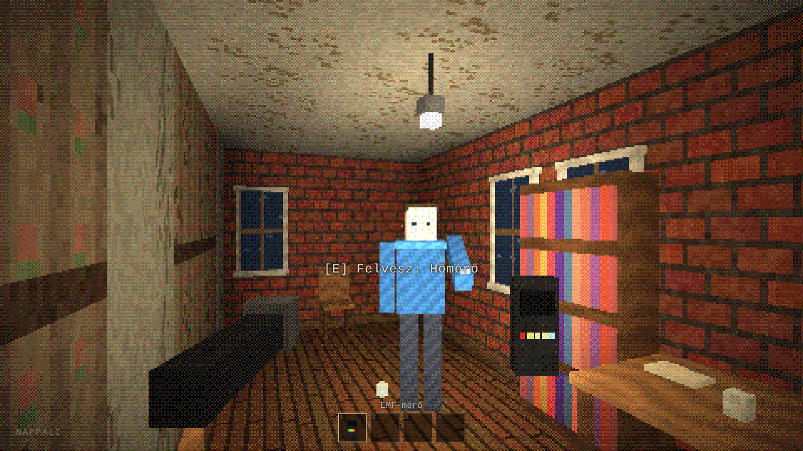
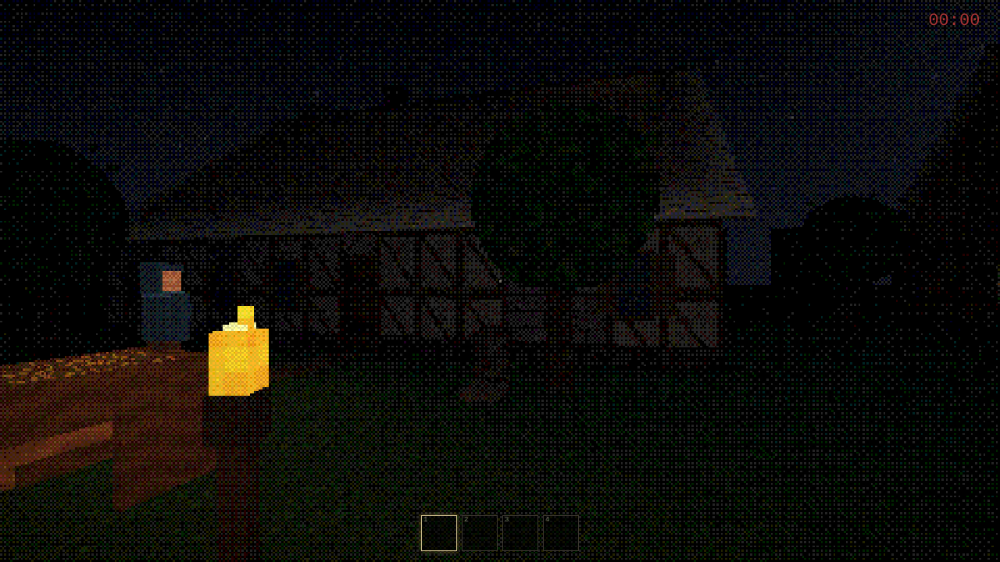
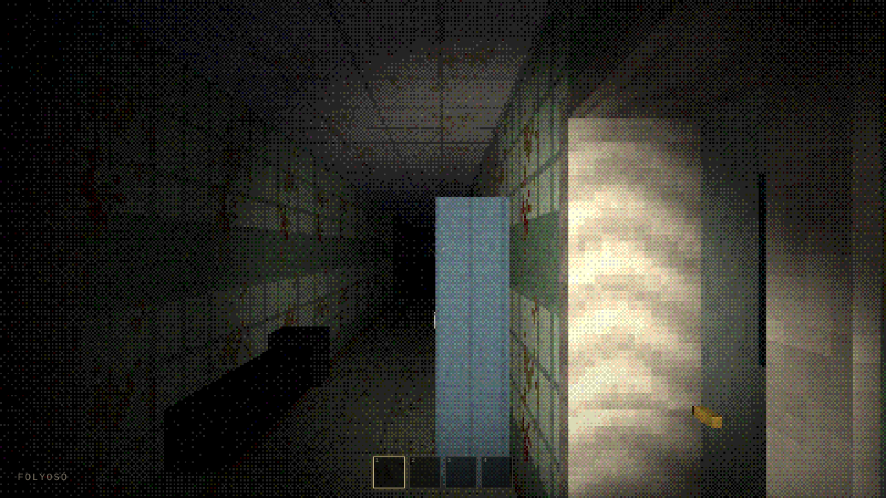
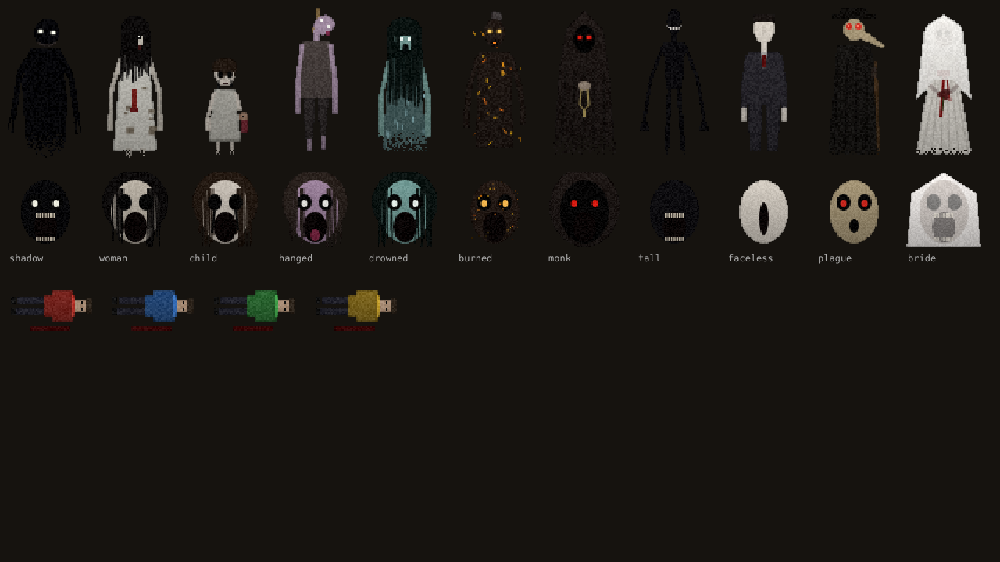
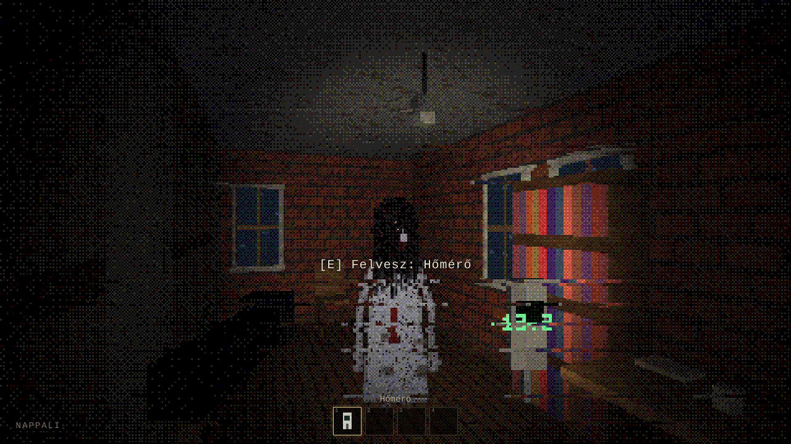
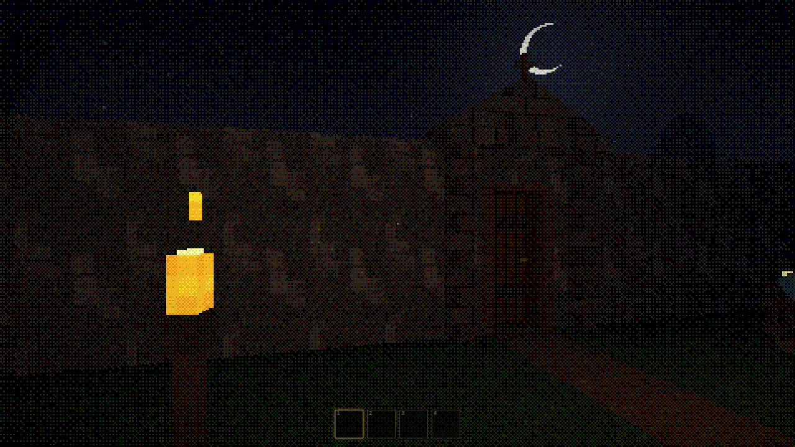
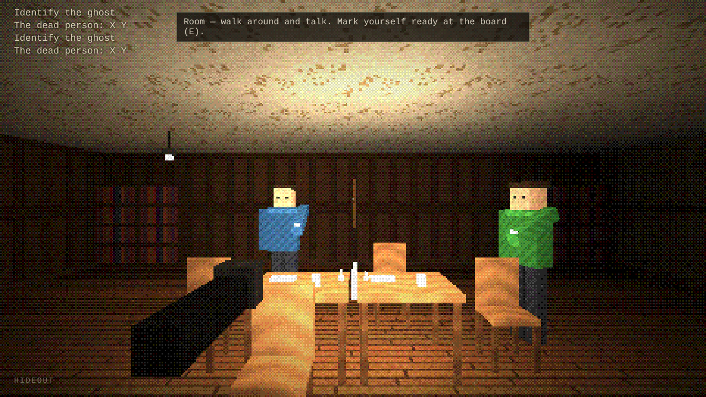

# GRAVEHUSH

**They are listening.**

### ▶ [PLAY NOW](https://rblackwood224.github.io/GraveHush/)

A first-person 3D pixel-art ghost hunting horror game in the browser. Solo or online co-op for up to 4 players, with proximity voice chat. The ghost hears your microphone.

## Play

**[https://rblackwood224.github.io/GraveHush/](https://rblackwood224.github.io/GraveHush/)**

Runs in the browser on PC, phone and tablet. No install needed.

## How to play

1. Take equipment from the crate next to the van (or the cart in the medieval era). You can carry 4 items.
2. Go inside and find the ghost's room. The cold is often the first sign.
3. Collect **evidence**. Every ghost leaves 3 of 7 kinds.
4. Find **clues** (notes, photos, toys). They tell how the person died.
5. Evidence + cause of death points to one ghost. Mark both in the journal (J) and choose your answer.
6. Complete the objective and end the mission at the van.

**Objectives** (random each mission):
- **Identify the ghost.**
- **Burn its bones**, then survive its rage.
- **Survive until dawn.**

### Hunts

There is no timer and no sanity bar. When the lights flicker and the front door slams, it is hunting. Run, hide in a wardrobe, locker or hay, and stay silent. It hears your microphone, and it remembers where you hid last time.

### 100 ghosts

There are 100 ghosts from world folklore: Lidérc, Banshee, Rusalka, Onryō, La Llorona and many more. Each one is built from:

- 30 behaviours (stalks one player, mimics your friends' voices, wears a friend's face, changes the house, loops corridors, leaves false evidence…)
- weaknesses and immunities (salt, fire, holy things, light, its own name, smoke)

The same ghost never acts the same way twice.

Rare scripted scares can happen once per mission: a figure crossing the corridor ahead, every door slamming one after another, the lights dying room by room toward you, pounding on a door, someone standing in a corner, a friend's voice calling you into the dark… and sometimes something stands right behind you. Turn around fast enough and you will see it. Correctly identified ghosts unlock in the **Ghostpedia**.

### Locations

Modern and medieval: house / manor, asylum / infirmary, school / abbey, farm.
Medieval only: **castle** (keep, throne room, armory, dungeon cells, courtyard with towers), **catacombs** (an underground labyrinth with ossuaries, tombs and iron gates — you can hide in a sarcophagus) and **church & graveyard** (nave with pews, sanctuary, sacristy, bell tower, gravedigger's hut, mausoleum).

### Eras

| Evidence | Modern | Medieval |
|---|---|---|
| Freezing room | Thermometer | Bowl of water |
| EMF 5 | EMF reader | Blue candle flame |
| Voice | Spirit box | Hand bell |
| Writing | Notebook | Quill & parchment |
| Prints | UV light | Pouch of ash |
| Lens | Night camera (orbs) | Hand mirror (a face) |
| Motion | Motion sensor | Thread with bells |

Protection: crucifix, salt, sage stick / Bible, lighter, holy water.

## Controls

| | Keyboard / mouse | Gamepad |
|---|---|---|
| Move / look | WASD / mouse | Sticks |
| Run | Shift | L3 / LT |
| Interact (doors, hide, read, pick up) | E / right click | A |
| Use item | Left click | X / RT |
| Device on/off | R | D-pad down |
| Place / drop item | Q | B |
| Switch item | 1–4 / mouse wheel | LB / RB |
| Light | F | Y |
| Ask the ghost | T (or speak) | D-pad up |
| Say its name | N (or speak) | — |
| Journal | J / Tab | Select |
| Push to talk | V | — |
| Pause | Esc | Start |

Touch controls appear automatically on phones and tablets.

## Online

**Host online game** gives you a 5-letter room code. Friends enter it under **Join online game** and appear in the **hideout**, a room where everyone can walk around and talk before the hunt. At the **mission board** (E) the host picks the era, location and difficulty, players mark themselves ready, and the host starts. After a mission everyone returns to the hideout.

Every player can use their own language (English, French, Hungarian) in the same game.

- Voice chat is proximity based: you hear friends from their direction, muffled through walls.
- Dead players can't be heard by the living.
- Speech recognition (Chrome / Edge) lets the ghost react to its name and to spoken questions.
- Voice clips the ghost uses for mimicry stay in your browser's memory and are never uploaded. You can turn this off in Settings.

## Tech

Plain HTML, CSS and JavaScript with its own WebGL2 3D engine (real buildings with roofs, windows and doors, voxel furniture and items, low-resolution dithered pixel look). Older devices without WebGL2 fall back to a classic raycaster. All textures, models and sounds are generated in code. Online play uses [PeerJS](https://peerjs.com/) (WebRTC, peer to peer).

---

Made by [RBlackwood224](https://github.com/RBlackwood224)
